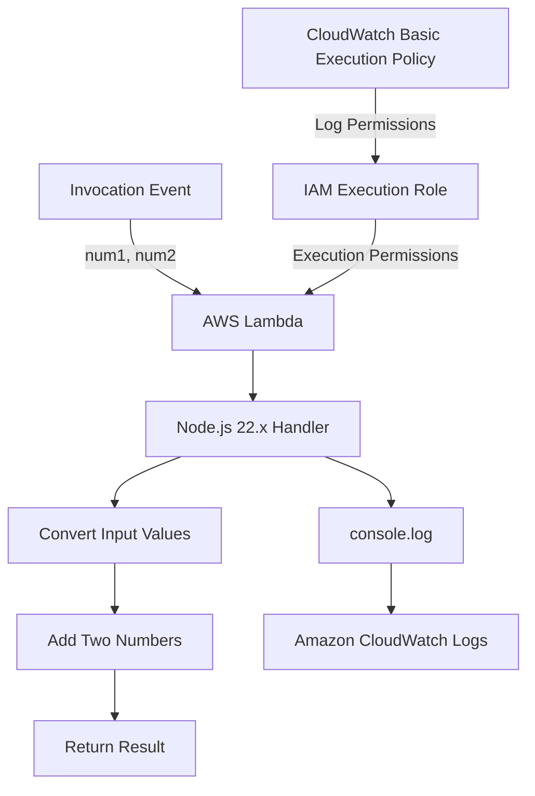

# AWS Lambda Function to Add Two Numbers with Terraform

Infrastructure as Code project that provisions an AWS Lambda function using Terraform to perform a basic arithmetic operation. The function receives two numeric values through an invocation event, calculates their sum, logs the input values and result, and returns the calculated response.

The infrastructure includes an IAM execution role with the required permissions, a ZIP deployment package, and an Amazon CloudWatch Log Group for centralized execution logging.

## Architecture

The infrastructure uses **AWS Lambda** to execute the addition function, **AWS IAM** to manage execution permissions, and **Amazon CloudWatch Logs** to collect and retain execution logs.



## Features

- **Serverless Execution:** Runs the arithmetic operation using AWS Lambda without managing servers.
- **Two-Number Addition:** Receives two numeric values through the invocation event and returns their sum.
- **Input Conversion:** Converts incoming values to JavaScript numbers before performing the calculation.
- **Execution Logging:** Records both input values and the calculated result using `console.log()`.
- **IAM Execution Role:** Defines the trust relationship required for AWS Lambda to assume its execution role.
- **CloudWatch Integration:** Publishes execution logs to a dedicated CloudWatch Log Group.
- **Log Retention:** Configures a seven-day retention period for execution logs.
- **ZIP Deployment Package:** Packages the Lambda source code using the Terraform Archive provider.
- **Infrastructure as Code:** Provisions and manages all AWS resources declaratively through Terraform.
- **ARM64 Architecture:** Uses the ARM64 instruction set for Lambda execution.

## Infrastructure Components

| AWS Resource | Description |
|---|---|
| `aws_iam_role` | Creates the execution role assumed by AWS Lambda. |
| `aws_iam_role_policy_attachment` | Attaches the AWS managed policy required for basic Lambda execution logging. |
| `aws_lambda_function` | Provisions the function that performs the addition operation. |
| `aws_cloudwatch_log_group` | Creates the dedicated CloudWatch Log Group. |
| `archive_file` | Packages the Lambda source code into a ZIP archive. |
| `aws_iam_policy_document` | Defines the IAM trust policy allowing Lambda to assume the execution role. |

## Lambda Configuration

The function uses Node.js 22.x and is configured with the following execution parameters:

| Property | Value |
|---|---|
| Function Name | `add_two_numbers` |
| Runtime | `nodejs22.x` |
| Handler | `index.handler` |
| Architecture | `arm64` |
| Memory | `512 MB` |
| Timeout | `16 seconds` |
| Deployment Package | ZIP |

### Function Input

The Lambda function receives an event containing two numeric properties:

```json
{
  "num1": 10,
  "num2": 20
}
```

The handler converts both values using JavaScript's `Number()` function and performs the addition operation.

### Function Response

For the example input, the function returns:

```json
{
  "statusCode": 200,
  "body": {
    "response": 30
  }
}
```

The calculated result is also printed to the execution logs.

## IAM Configuration

The Lambda execution role uses an IAM trust policy that allows the `lambda.amazonaws.com` service principal to assume the role.

The AWS managed policy `AWSLambdaBasicExecutionRole` is attached to provide the basic permissions required for CloudWatch Logs integration.

This managed policy provides permissions for:

- `logs:CreateLogGroup`
- `logs:CreateLogStream`
- `logs:PutLogEvents`

## CloudWatch Configuration

Amazon CloudWatch Logs collects the output generated by the Lambda function during execution.

The Log Group is explicitly managed through Terraform.

| Property | Value |
|---|---|
| Log Group | `/aws/lambda/add_two_numbers` |
| Retention Period | 7 days |
| Log Source | AWS Lambda |
| Logging Method | `console.log()` |

### Execution Logs

Each invocation generates log entries containing:

- First input number.
- Second input number.
- Calculated sum.

These logs provide visibility into function executions and help identify potential issues during troubleshooting.

## Project Structure

```text
.
├── src/
│   └── index.js
├── .gitignore
├── .terraform.lock.hcl
├── main.tf
└── provider.tf
```

| File | Responsibility |
|---|---|
| `src/index.js` | Implements the Lambda handler and addition logic. |
| `main.tf` | Defines the IAM role, deployment package, Lambda function, IAM policy attachment and CloudWatch Log Group. |
| `provider.tf` | Configures the Terraform version, AWS provider, Archive provider and AWS region. |
| `.terraform.lock.hcl` | Locks the Terraform provider versions and dependency checksums. |
| `.gitignore` | Excludes Terraform state files, local configuration and generated files from version control. |

## Prerequisites

- Terraform installed.
- AWS CLI installed.
- AWS credentials configured.
- An AWS account with permissions to manage Lambda, IAM and CloudWatch Logs.

## Deployment

### 1. Initialize Terraform

Downloads and initializes the required Terraform providers.

```bash
terraform init
```

### 2. Validate the Configuration

Checks the Terraform configuration for syntax and consistency errors.

```bash
terraform validate
```

### 3. Review Infrastructure Changes

Displays the resources Terraform intends to create or modify.

```bash
terraform plan
```

### 4. Deploy the Infrastructure

Creates the IAM role, Lambda function and CloudWatch Log Group.

```bash
terraform apply
```

Confirm the deployment when prompted.

## Testing and Verification

### Invoke the Lambda Function

Create an event payload:

```bash
echo '{"num1":10,"num2":20}' > event.json
```

Invoke the deployed function:

```bash
aws lambda invoke \
  --function-name add_two_numbers \
  --payload fileb://event.json \
  response.json
```

Inspect the function response:

```bash
cat response.json
```

Expected result:

```json
{
  "statusCode": 200,
  "body": {
    "response": 30
  }
}
```

### Verify the Lambda Function

```bash
aws lambda get-function \
  --function-name add_two_numbers \
  --region us-east-1
```

### Verify CloudWatch Log Group

```bash
aws logs describe-log-groups \
  --log-group-name-prefix /aws/lambda/add_two_numbers \
  --region us-east-1
```

### Inspect Execution Logs

```bash
aws logs tail /aws/lambda/add_two_numbers \
  --follow \
  --region us-east-1
```

The output should contain the two input values and their calculated sum.

## Cleanup

To remove the infrastructure provisioned by Terraform:

```bash
terraform destroy
```

Confirm the operation when prompted.

---

**Technologies:** AWS · Terraform · AWS Lambda · Node.js · AWS IAM · Amazon CloudWatch Logs · Infrastructure as Code
